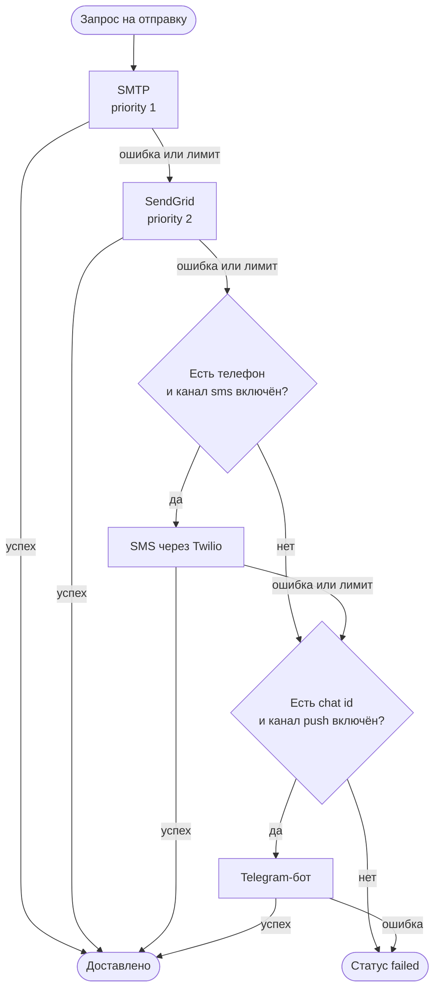

# NotifyChain

[](https://github.com/Tikhovskoy/NotifyChain/actions/workflows/ci.yml)

Сервис уведомлений с автоматическим fallback: если провайдер или целый канал недоступен, сообщение уходит через следующий. Внешние системы отправляют уведомления по REST API с токеном, а сервис сам доводит их до получателя.

Стек: Django 5.2 LTS, Django REST Framework, Celery, Redis, PostgreSQL, Python 3.12.

## Как работает fallback

Доставка устроена в два уровня.

1. **Между провайдерами одного канала.** Провайдеры канала пробуются по возрастанию `priority`. Провайдер пропускается, если он неактивен, исчерпал лимит или вернул ошибку.
2. **Между каналами.** Если не сработал ни один провайдер канала, сервис переходит к следующему каналу в порядке **email → sms → push**. Каналы пропускаются, если у получателя нет адреса (email, телефона, chat id) или он отключил канал в настройках.



Канал, с которого начинается доставка, задаётся в запросе; назад по цепочке сервис не возвращается (для `sms` пробуются только `sms → push`). Итог пишется в журнал уведомления, а каждая попытка у провайдера (успешная и неудачная) попадает в его статистику. Если сообщение ушло по запасному каналу, в уведомлении сохраняются фактические `channel` и `recipient_address`.

## Быстрый старт (Docker)

```bash
git clone https://github.com/Tikhovskoy/NotifyChain.git
cd NotifyChain

cp .env.example .env
# Откройте .env и задайте SECRET_KEY, ALLOWED_HOSTS, DB_PASSWORD и ключи нужных провайдеров

docker compose up -d --build

docker compose exec web python manage.py migrate
docker compose exec web python manage.py setup_providers       # SMTP, SendGrid, Twilio, Telegram
docker compose exec web python manage.py createsuperuser
```

Сервис слушает порт 8000: [http://localhost:8000/api/docs/](http://localhost:8000/api/docs/) — Swagger UI (ассеты подгружаются с CDN jsDelivr), [http://localhost:8000/admin/](http://localhost:8000/admin/) — админ-панель.

> Для локального запуска по HTTP добавьте в `.env` строку `SECURE_SSL_REDIRECT=False`: по умолчанию в production включён редирект на HTTPS.

### Токен для внешней системы

API закрыт для анонимов. Внешняя система ходит с токеном, который выдаёт администратор:

```bash
# Создаёт сервисную учётную запись без пароля и печатает токен
docker compose exec web python manage.py issue_token billing-service --create

# Повторный вызов печатает тот же токен; --rotate заменяет его новым
docker compose exec web python manage.py issue_token billing-service --rotate
```

### Пример: отправить уведомление

```bash
curl -X POST http://localhost:8000/api/notifications/send/ \
  -H "Authorization: Token <токен>" \
  -H "Content-Type: application/json" \
  -d '{
        "recipient_id": 1,
        "channel": "email",
        "subject": "Важное уведомление",
        "message": "Ваш заказ готов к получению",
        "priority": "high"
      }'
```

Ответ `201` содержит уведомление и поле `sent_immediately`. Статус и журнал попыток можно получить так:

```bash
curl -H "Authorization: Token <токен>" http://localhost:8000/api/notifications/1/
```

## API

Полная схема с примерами запросов: `/api/docs/` (Swagger UI) и `/api/schema/` (OpenAPI 3).

| Метод и путь | Что делает | Кто может |
|---|---|---|
| `POST /api/notifications/send/` | Создать и сразу отправить | любой с токеном |
| `POST /api/notifications/send_async/` | Создать и поставить отправку в очередь Celery | любой с токеном |
| `POST /api/notifications/send_bulk/` | Создать уведомления для списка `recipient_ids`, не отправляя | любой с токеном |
| `POST /api/notifications/send_bulk_async/` | Создать для списка и поставить в очередь | любой с токеном |
| `GET /api/notifications/`, `GET /api/notifications/{id}/` | Список и карточка уведомлений | свои; администратор видит все |
| `POST /api/notifications/{id}/retry/` | Повторная отправка неудавшегося | владелец, администратор |
| `GET /api/notifications/pending/`, `/failed/`, `/stats/` | Очереди и статистика | свои; администратор видит все |
| `GET /api/templates/`, `GET /api/templates/{id}/` | Шаблоны | любой с токеном |
| `POST/PUT/PATCH/DELETE /api/templates/` | Управление шаблонами | только администратор |
| `POST /api/templates/{id}/preview/`, `/validate_template/` | Предпросмотр и проверка шаблона | любой с токеном |
| `/api/providers/` (+ `{id}/test/`, `{id}/stats/`, `available/`) | Провайдеры, проверка и статистика | только администратор |
| `GET /api/usage/` | Почасовая статистика провайдеров | только администратор |

Массовая отправка:

```bash
curl -X POST http://localhost:8000/api/notifications/send_bulk_async/ \
  -H "Authorization: Token <токен>" -H "Content-Type: application/json" \
  -d '{"recipient_ids": [1, 2, 3], "channel": "email", "subject": "Новости", "message": "Доступна новая версия"}'
```

Из ответов API никогда не отдаётся `config` провайдера: его можно записать, но не прочитать.

### Ошибки

| Код | Когда | Тело ответа |
|---|---|---|
| 400 | Неверные данные | поля с ошибками (формат DRF) или `{"error": "...", "code": "validation_error"}` |
| 401 | Нет токена или он неверный | `{"detail": "..."}` |
| 403 | Недостаточно прав | `{"detail": "..."}` |
| 404 | Объект не найден | `{"detail": "..."}` или `{"error": "...", "code": "provider_not_found"}` |
| 409 | Конфликт состояния: получатель отключил канал, уведомление не готово к отправке, нет доступного провайдера | `{"error": "...", "code": "..."}` |
| 429 | Превышен throttling | `{"detail": "..."}` |
| 500 | Непредвиденная ошибка | `{"error": "Внутренняя ошибка сервера", "code": "server_error"}`, подробности только в логе |

### Лимиты

* **Throttling API** на пользователя и на анонима: `API_THROTTLE_USER` (по умолчанию `120/min`) и `API_THROTTLE_ANON` (`20/min`).
* **Лимиты провайдеров** в минуту и в час хранятся у каждого `Provider` (`rate_limit_per_minute`, `rate_limit_per_hour`). Счётчики лежат в кэше Django: в production это Redis (база `1`, отдельная от очереди Celery), поэтому лимит общий для всех процессов. Провайдер, исчерпавший лимит, пропускается в пользу следующего. `RATE_LIMIT_ENABLED=False` отключает проверку.

## Провайдеры и переменные окружения

Классы провайдеров читают ключи из окружения напрямую. Нужны только те, которыми вы пользуетесь; шаблон со всеми переменными лежит в `.env.example`.

| Канал | Провайдер | Переменные | Получатель |
|---|---|---|---|
| email | SMTP | `SMTP_HOST`, `SMTP_PORT`, `SMTP_USE_TLS`, `SMTP_USERNAME`, `SMTP_PASSWORD`, `FROM_EMAIL` | `User.email` |
| email | SendGrid | `SENDGRID_API_KEY`, `SENDGRID_FROM_EMAIL` | `User.email` |
| sms | Twilio | `TWILIO_ACCOUNT_SID`, `TWILIO_AUTH_TOKEN`, `TWILIO_FROM_NUMBER` | `UserProfile.phone_number` |
| push | Telegram-бот | `TELEGRAM_BOT_TOKEN` | `UserProfile.push_token` (chat id) |

Команда `setup_providers` заводит четыре провайдера (`smtp_email`, `sendgrid_email`, `twilio_sms`, `telegram_bot`). Порядок fallback, лимиты и активность настраиваются в админ-панели или через `/api/providers/`. Свой провайдер добавляется наследованием от `BaseProvider` и регистрацией в `apps/providers/services/registry.py`.

Остальные переменные:

| Переменная | Назначение |
|---|---|
| `SECRET_KEY`, `ALLOWED_HOSTS` | Обязательны в production |
| `DATABASE_URL`, `REDIS_URL` | Обязательны в production; в compose подставляются автоматически |
| `DB_PASSWORD` | Пароль PostgreSQL для compose |
| `SECURE_SSL_REDIRECT` | Редирект на HTTPS, по умолчанию включён |
| `TRUST_X_FORWARDED_PROTO` | Включите, если TLS завершает прокси (nginx, Traefik) |
| `CORS_ALLOWED_ORIGINS` | Список разрешённых origin через запятую |
| `GUNICORN_WORKERS` | Число процессов gunicorn, по умолчанию 3 |

## Настройки Django

Настройки — пакет `notifychain/settings/`; нужный модуль выбирает `DJANGO_SETTINGS_MODULE`:

| Модуль | Где используется | Особенности |
|---|---|---|
| `notifychain.settings.dev` | `manage.py`, тесты, dev-compose | `DEBUG` включён, у `SECRET_KEY` безопасное значение по умолчанию |
| `notifychain.settings.production` | gunicorn, `wsgi.py`, `asgi.py`, Celery, Docker | `DEBUG=False`, PostgreSQL и Redis, HTTPS-заголовки, логи в stdout; без `SECRET_KEY`, `ALLOWED_HOSTS`, `DATABASE_URL`, `REDIS_URL` не запускается |

Проверка боевых настроек (в CI выполняется на каждый коммит):

```bash
DJANGO_SETTINGS_MODULE=notifychain.settings.production python manage.py check --deploy --fail-level WARNING
```

## Разработка

С Docker: runserver, dev-настройки и код из рабочей папки.

```bash
docker compose -f docker-compose.yml -f docker-compose.dev.yml up --build
```

Без Docker (нужны Python 3.12 и Redis для Celery; БД по умолчанию SQLite):

```bash
python -m venv .venv
source .venv/bin/activate            # Windows: .venv\Scripts\activate
pip install -r requirements-dev.txt

python manage.py migrate
python manage.py setup_providers
python manage.py createsuperuser
python manage.py runserver

# воркер Celery в отдельном терминале
DJANGO_SETTINGS_MODULE=notifychain.settings.dev celery -A notifychain worker -l info
```

Проверки (те же шаги выполняет CI):

```bash
ruff check .
ruff format --check .
python manage.py makemigrations --check --dry-run
coverage run manage.py test && coverage report     # порог покрытия apps/ — 70%
```

Тесты используют моки вместо реальных провайдеров, сеть и ключи не нужны. Сквозной сценарий SMTP → SendGrid → Twilio → Telegram лежит в `apps/notifications/test_delivery_chain.py`.

### Зависимости

Прямые зависимости перечислены в `requirements.in` и `requirements-dev.in`, полный список с точными версиями — в `requirements.txt` и `requirements-dev.txt`. Обновить lock-файлы удобно в том же окружении, где работает CI (Linux, Python 3.12):

```bash
docker run --rm -v "$PWD:/work" -w /work python:3.12-slim sh -c \
  "pip install -q pip-tools && \
   pip-compile --strip-extras requirements.in && \
   pip-compile --strip-extras requirements-dev.in"
```

## Структура проекта

```
apps/
  notifications/   модели уведомлений и шаблонов, NotificationService, API
  providers/       Provider и статистика, ProviderManager и его части:
                   registry.py (выбор провайдера), rate_limiter.py, usage_recorder.py
  users/           профили, предпочтения каналов, команда issue_token
  monitoring/      модели метрик
tasks/             задачи Celery
notifychain/       settings/{base,dev,production}.py, urls, celery
```

## Лицензия

[MIT](LICENSE)
